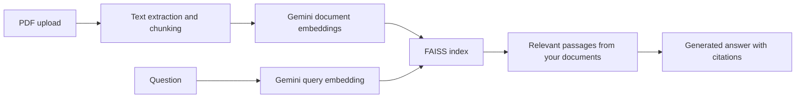

# Folio

Ask questions about your PDFs and check the passages behind each answer.

[Live application](https://pdf-knowledge-assistant.onrender.com) · [API documentation](https://pdf-knowledge-assistant.onrender.com/docs)

## Features

- Google sign-in with private document libraries and user-scoped chat history.
- PDF uploads with ingestion progress and failure reporting.
- Semantic retrieval using Gemini embeddings and a FAISS vector index.
- Answers with page references, source excerpts, and links to the original PDF.
- Document-specific or library-wide search.
- A read-only sample workspace that requires no account or API key.

## How it works



The backend uses FastAPI, PyMuPDF, NumPy, FAISS, and SQLAlchemy. The frontend uses HTML, CSS, and JavaScript. Google OAuth identifies users; signed JWTs authorize access to their documents.

## Run locally

Requires Python 3.11 or newer.

```sh
python -m venv .venv
# Activate .venv using the command for your shell.
pip install -r requirements.txt
cp .env.example .env
uvicorn app.main:app --host 127.0.0.1 --port 8000
```

On PowerShell, use `Copy-Item .env.example .env`. Open http://localhost:8000. The public sample uses fictional documents and local retrieval; it does not call an AI provider.

For your own PDFs, configure Google OAuth and the provider settings below. Never commit `.env` or real credentials.

## Configuration

### Online semantic retrieval

```env
EMBEDDING_PROVIDER=gemini
EMBEDDING_MODEL=models/gemini-embedding-001
EMBEDDING_DIMENSION=768
LLM_PROVIDER=gemini
GEMINI_MODEL=gemini-2.5-flash
GEMINI_API_KEY=your-key
```

Document and query embeddings must use the same provider, model, and dimension. Gemini embeddings run through a hosted API and do not require a local model or GPU. Provider quotas and pricing apply independently of your hosting plan.

### Offline development

```env
EMBEDDING_PROVIDER=hash
LLM_PROVIDER=mock
```

Hash embeddings match lexical features rather than semantic meaning. Use them for offline development, not as a substitute for semantic retrieval on technical documents. The answer provider and embedding provider are separate settings: enabling Gemini answers alone does not enable Gemini embeddings.

### Authentication and storage

| Variable | Purpose |
| --- | --- |
| `GOOGLE_CLIENT_ID`, `GOOGLE_CLIENT_SECRET` | Google OAuth web application credentials |
| `GOOGLE_REDIRECT_URI` | Callback URL, ending in `/api/auth/google/callback` |
| `FRONTEND_URL`, `CORS_ORIGINS` | Public application URL and allowed origins |
| `JWT_SECRET_KEY`, `OAUTH_STATE_SECRET` | Distinct random secrets of at least 32 characters in production |
| `DATABASE_URL` | SQLAlchemy database URL; SQLite by default |
| `UPLOAD_DIR`, `INDEX_DIR` | PDF and vector-index storage directories |
| `MAX_UPLOAD_MB` | Upload limit; defaults to 10 MB |
| `CHUNK_SIZE`, `CHUNK_OVERLAP` | Passage length and overlap in characters |
| `TOP_K` | Maximum number of retrieved passages |
| `MIN_RETRIEVAL_SCORE` | Minimum similarity for including a passage |

Register the exact callback URL in your Google OAuth client. For local development, use `http://localhost:8000/api/auth/google/callback`. See [.env.example](.env.example) for all settings.

## Deploy on Render

1. Connect this repository and use the included Dockerfile or `render.yaml`.
2. Keep the repository root as the build directory.
3. Set the OAuth credentials, application URLs, provider key, and production secrets.
4. Use `/api/health` as the health-check path.
5. Run one application worker.

The supplied Blueprint uses Render's free plan. Free instances sleep when idle and have ephemeral storage: uploaded PDFs, SQLite data, and indexes can be lost on restart or redeployment. This configuration does **not** include a persistent disk. Durable document libraries require persistent storage for all three; moving only the SQL database does not preserve PDFs or FAISS files.

After changing the embedding provider, model, or dimension, re-upload your PDFs to build compatible vectors. Existing hash vectors cannot be searched with semantic query vectors. Keep copies of your original PDFs before redeploying a free instance.

## API

Interactive documentation is available at `/docs`. Personal-library endpoints require an application JWT in the `Authorization: Bearer <token>` header.

| Method | Endpoint | Purpose |
| --- | --- | --- |
| GET | `/api/health` | Health check |
| GET | `/api/capabilities` | Active retrieval and answer modes |
| POST | `/api/ingestions` | Upload a PDF and start ingestion |
| GET | `/api/ingestions/{job_id}` | Check ingestion progress |
| GET | `/api/documents` | List your documents |
| POST | `/api/ask` | Ask a question about your documents |
| DELETE | `/api/documents/{document_id}` | Delete one of your documents |

Example question body:

```json
{"question": "What are the main findings?", "document_id": null, "top_k": 8}
```

## Troubleshooting

- **The answer says information is missing:** select the correct document, check the retrieved excerpts, and confirm `/api/capabilities` reports `gemini` retrieval. Re-upload documents after an embedding configuration change.
- **Scanned PDF has no usable text:** apply OCR before uploading; OCR is not included.
- **Provider request fails:** check the API key, model availability, and provider quota. The app does not silently replace semantic embeddings with hash embeddings.
- **Documents disappear after redeployment:** free Render storage is ephemeral; upload the PDFs again or configure durable storage.

Citations help inspect an answer but do not guarantee correctness. Similarity scores are not confidence scores. Ingestion uses in-process background tasks; interrupted jobs are marked failed after restart.

## Tests

```sh
python -m unittest discover -s tests -v
```

Tests cover ingestion, document ownership, authentication, retrieval filtering, and index recovery. External provider and OAuth calls are mocked; live integrations require separate verification.
